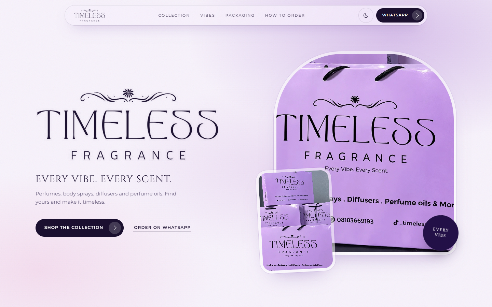
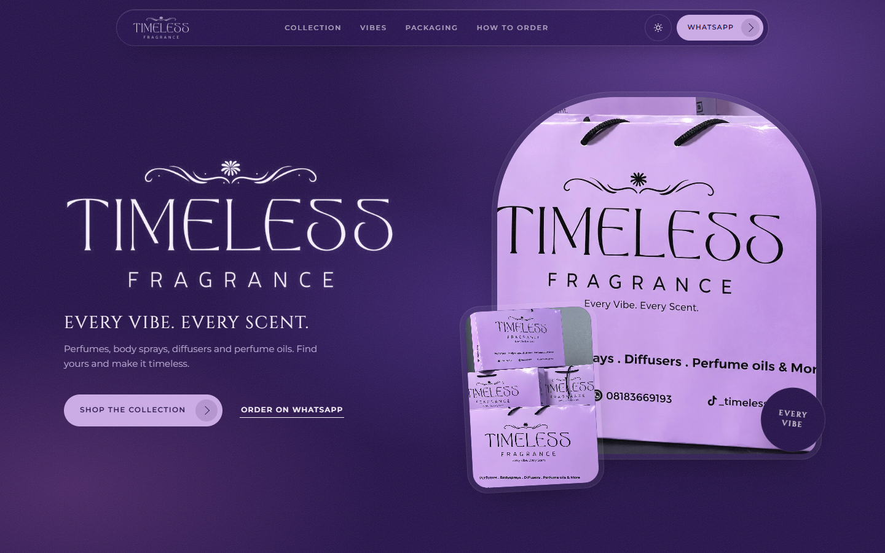

# Timeless Fragrance

A one-page storefront for **Timeless Fragrance** ([@_timelessfragrance](https://www.tiktok.com/@_timelessfragrance) on TikTok): perfumes, body sprays, diffusers and perfume oils, with every product ordering straight through WhatsApp.

Live: https://timelessfragrance.vercel.app

## What it is

- Plain static HTML, CSS and JavaScript. No build step.
- Her real logo, lavender packaging photos and brand palette (midnight indigo, lilac, orchid). Cinzel and Montserrat for type.
- **Light and dark mode**: lavender-white by default, deep purple in dark. The toggle in the nav remembers the choice.
- Sections: hero, categories, searchable collection (tabs, vibe filter, size picker), vibes, packaging, the "they owe you a perfume" letter game, meet MO, how to order, FAQ and a closing call to action.
- Every order button opens WhatsApp with a pre-filled message. Mobile gets a sticky "Order on WhatsApp" bar.

## Editing the catalog

Everything lives in [`catalog.js`](catalog.js): WhatsApp number, categories, vibes and products (name, notes, sizes, prices). Set `price` to a number for naira, or `null` to show "Ask for price". Remove `sample: true` once an item is real.

Product photos: save `images/products/<product-id>.jpg` (4:5 works best). Until the file exists, a branded bottle illustration shows.

## Replacing placeholder images

The photos in `images/` (`hero.jpg`, `bag-wide.jpg`, `bag-close.jpg`, `bag-qr.jpg`, `note.jpg`) are upscaled stills from the brand's videos; the originals are in `source-frames/`. Save a better file over the same name and the site picks it up. `tools/build_images.py --force` rebuilds the low-res placeholders.

## Tools

`tools/` holds the helper scripts (Python + Playwright with Edge): `build_images.py`, `render.py` (social image and touch icon) and `shoot.py` (screenshots; serve the folder on port 8123 first).

## Run locally

Serve the folder with any static server, for example `python -m http.server 8123`. The logo uses CSS masks, so opening `index.html` straight from disk won't render it.
