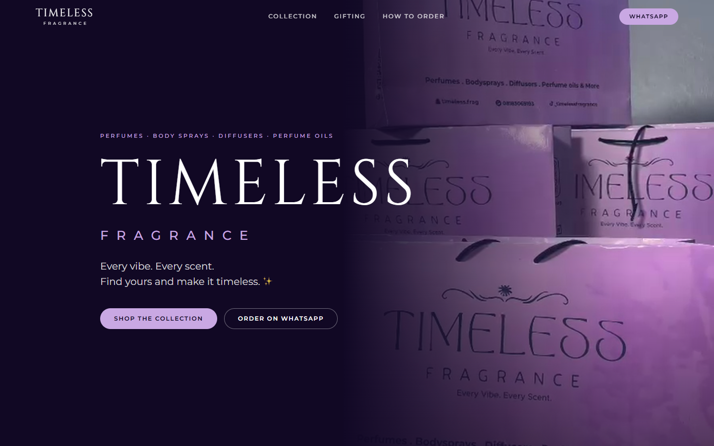

# Timeless Fragrance

A one-page storefront for **Timeless Fragrance** ([@_timelessfragrance](https://www.tiktok.com/@_timelessfragrance) on TikTok): perfumes, body sprays, diffusers and perfume oils, with every product ordering straight through WhatsApp.

Live: https://timeless-fragrance.vercel.app

## What it is

- Plain static HTML, CSS and JavaScript. No build step.
- Brand palette taken from the lavender packaging: midnight indigo, lilac and orchid.
- Catalog with category tabs, vibe filter, size picker and a pre-filled WhatsApp message per product.
- Mobile-first, with a sticky "Order on WhatsApp" bar.

## Editing the catalog

Everything lives in [`catalog.js`](catalog.js): WhatsApp number, categories, vibes and products (name, notes, sizes, prices). Set `price` to a number for naira, or `null` to show "Ask for price". Remove `sample: true` once an item is real.

Product photos: save `images/products/<product-id>.jpg` (4:5 works best). Until the file exists, a branded bottle illustration shows.

## Replacing placeholder images

Hero, gifting and social images are stills from the brand's videos. Upscale any file in `source-frames/` and save it over the matching name in `images/` (`hero.jpg`, `packaging.jpg`, `stack.jpg`) and the site picks it up. `tools/build_images.py` regenerates the placeholders.

## Tools

`tools/` holds the helper scripts (Python + Playwright with Edge): `build_images.py`, `render.py` (social image and touch icon) and `shoot.py` (screenshots).

## Run locally

Open `index.html`, or serve the folder with any static server.
